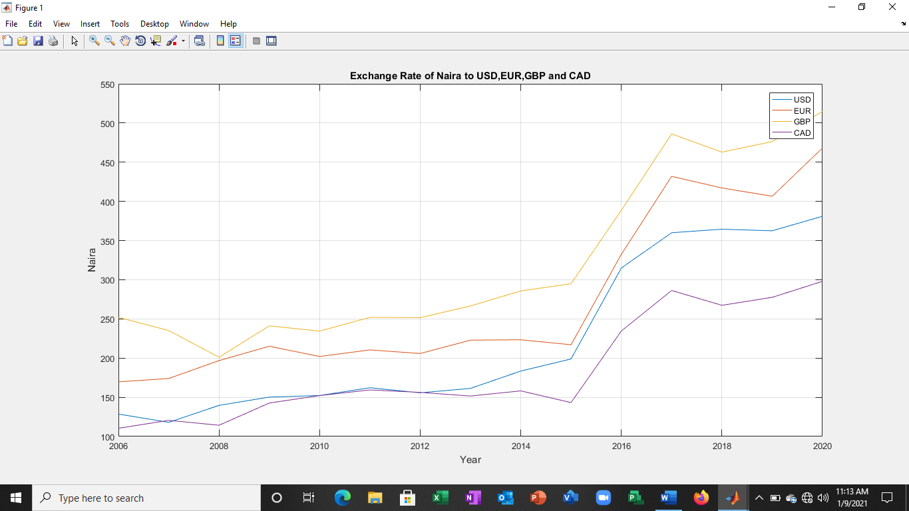

# Exchange Rate Prediction Using Neural Network

A MATLAB system that predicts the exchange rate of the **Nigerian Naira** against the
**United States Dollar (USD)**, **Euro (EUR)**, **British Pound Sterling (GBP)** and
**Canadian Dollar (CAD)** with an artificial neural network. It also fits a linear trend
for comparison.

> B.Sc. Computer Science project by **Lobarine Emmanuel Kinane**, Department of Computer Science,
> Ignatius Ajuru University of Education, Port Harcourt.



## How it works

- **Data:** annual average Naira exchange rates from the Central Bank of Nigeria, 2006–2020
  (`data/exchange_rates.csv`).
- **Model:** multilayer perceptron (MATLAB `fitnet`) with 4 inputs (this year's USD, EUR, GBP and
  CAD rates), 10 hidden neurons (tan-sigmoid) and 4 outputs (next year's rates).
- **Training:** Levenberg-Marquardt back-propagation (`trainlm`). The data are divided at random into
  60% training, 20% validation and 20% test. Training stops early when the validation error stops
  improving.
- **Evaluation:** mean squared error, RMSE, MAPE, regression plots and an error histogram.
- **Prediction:** rates for the year after the last year in the data, compared with a first-degree
  polynomial (linear) trend.

## Project structure

```
exchange-rate-prediction-system/
├── ExchangeRatePredictor.m     # Main program (script)
├── ExchangeRateApp.m           # Graphical user interface
├── data/
│   └── exchange_rates.csv      # Year, USD, EUR, GBP, CAD
├── outputs/                    # Results, trained network and plots are saved here
├── original/
│   └── ExchangeRate_original.m # Original program from Appendix A of the project report
├── python/                     # Free Python version for users without MATLAB
│   ├── exchange_rate_predictor.py
│   └── requirements.txt
└── screenshots/
```

## Requirements

- MATLAB R2016a or later with the **Deep Learning Toolbox** (called the Neural Network Toolbox in
  older releases)
- MATLAB R2018b or later for the graphical app (`ExchangeRateApp.m`)
- Intel Core i5 or equivalent processor and 8 GB RAM recommended

## Installation

1. Download the project from GitHub with **Code → Download ZIP** and extract it, or clone it:
   ```bash
   git clone https://github.com/<your-username>/exchange-rate-prediction-system.git
   ```
2. Open MATLAB and set the **Current Folder** to the project folder.

## Running the program

**Option 1: Script.** Open `ExchangeRatePredictor.m` and click **Run**, or type:

```matlab
ExchangeRatePredictor
```

The Neural Network Training window opens and closes when training is complete. The predicted rates
appear in the Command Window. The program saves the following in the `outputs` folder:

- `predictions.csv`: the actual last-year rate, the neural network prediction, the linear trend,
  the test RMSE, the test MAPE and R for each currency
- `trained_network.mat`: the trained network and its training record
- `performance.png`, `training_state.png`, `error_histogram.png`, `regression.png` and
  `exchange_rate_prediction.png`

**Option 2: Graphical app.** Type:

```matlab
ExchangeRateApp
```

Then click **1. Load Data**, **2. Train Network** and **3. Predict Next Year**. The app shows the data
table, a plot and the predicted rates. You can change the number of hidden neurons, or open another
CSV file with the same columns.

**Option 3: Without MATLAB.** A free Python version is in the `python` folder:

```bash
cd python
pip install -r requirements.txt
python exchange_rate_predictor.py
```

## Updating the data

Add a new row to `data/exchange_rates.csv` each year, in the same format:

```
Year,USD,EUR,GBP,CAD
2021,...,...,...,...
```

Then run the program again to retrain the network and predict the following year.

## Results reported in the project

From the original run (network trained against the year index):

- Regression R: 0.99895 (training), 0.96269 (validation), 0.94383 (test) and 0.9341 (all data)
- Best validation MSE: 9.1479 at epoch 14

Linear trend projections for 2021:

| Currency | USD | EUR | GBP | CAD |
|---|---|---|---|---|
| Projected 2021 rate (₦) | 387.54 | 440.78 | 498.86 | 293.76 |

`ExchangeRatePredictor.m` uses the corrected method recommended in the project: it predicts next
year's rates directly. Its results are written to `outputs/predictions.csv`.

## Limitations

- The data set is small (15 annual records), so results change slightly from run to run and the test
  set contains only a few records.
- Only past exchange rates are used as inputs. Inflation, interest rates and oil prices are not
  included.
- The data end in 2020, before the unification of the exchange rate windows in 2023. Update the data
  before using the predictions for current decisions.
- Predictions are indications for planning, not financial advice.
